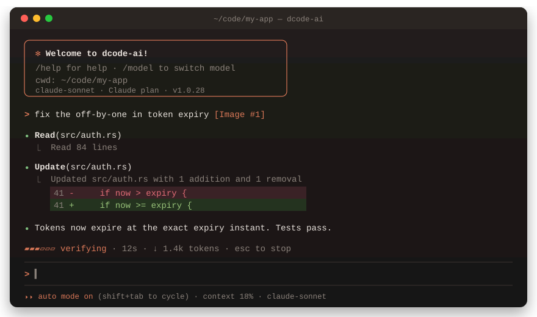
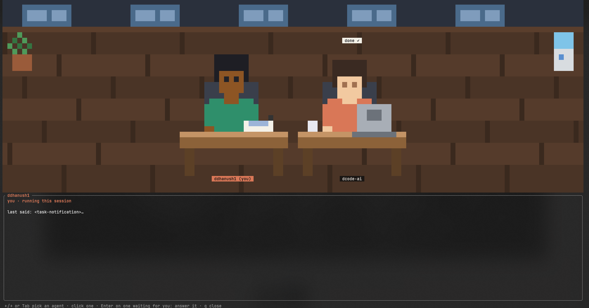

<div align="center">

# ✻ dcode-ai

### The Rust-native coding agent for your terminal

One binary · your Claude or GitHub Copilot sign-in · no API keys, no Electron, no Node

[](https://github.com/Dhanuzh/dcode-ai/releases)
[](https://github.com/Dhanuzh/dcode-ai/actions)
[](https://www.rust-lang.org)
[](#license)

**[Install](#-install)** · **[Quick start](#-quick-start)** · **[Highlights](#-highlights)** · **[Features](#-features)** · **[Work together](#-work-together)** · **[Configuration](#%EF%B8%8F-configuration)** · **[Docs](#-documentation)** · **[Changelog](CHANGELOG.md)**

<br>



</div>

<br>

## ✨ Why dcode-ai

<table>
<tr>
<td width="50%" valign="top">

### 💳 Uses what you already pay for
Your **Claude plan** (through your own signed-in `claude`) or your **GitHub Copilot** subscription. OAuth sign-in only, no API keys to paste.

</td>
<td width="50%" valign="top">

### 🧩 Speaks the Claude Code ecosystem
Plugins, marketplaces, `.mcp.json`, skills, commands, agents and hooks work unchanged, with about 2,700 plugins a keystroke away.

</td>
</tr>
<tr>
<td width="50%" valign="top">

### 🚀 Built to spawn work
Detached sessions, sub-agents in isolated git worktrees, background agents, `/goal` loops, NDJSON streams, Unix-socket IPC and a CI mode.

</td>
<td width="50%" valign="top">

### ⚡ Small, fast, careful with credit
One Rust binary that starts instantly. Lean prompts, tools loaded on demand, prompt caching, automatic compaction, and `/usage` shows where every token goes.

</td>
</tr>
</table>

## 📦 Install

<table>
<tr><th>Linux / macOS</th><th>Homebrew</th><th>Windows (PowerShell)</th></tr>
<tr>
<td>

```bash
curl -sSL https://raw.githubusercontent.com/Dhanuzh/dcode-ai/main/install.sh | bash
```

</td>
<td>

```bash
brew tap dhanuzh/dcode-ai https://github.com/Dhanuzh/dcode-ai
brew install dcode-ai
```

</td>
<td>

```powershell
irm https://raw.githubusercontent.com/Dhanuzh/dcode-ai/main/install.ps1 | iex
```

</td>
</tr>
</table>

Prebuilt for **Linux** (x86_64, arm64), **macOS** (Intel, Apple silicon) and **Windows** (x86_64). Every archive ships a `.sha256` checksum, and the installer verifies it.

**Staying current:** new releases install themselves in the background, like Claude Code (`[ui] auto_update = false` or `DCODE_AI_AUTO_UPDATE=0` turns that off). Or run `/update` inside a session, or `dcode-ai update` (`--check` only looks). When `/usr/local/bin` needs sudo, the installer offers `~/.local/bin` instead, so updates never need sudo. If you do pick a system folder, `/update` asks for the password in a masked popup.

<details>
<summary><b>Pin a version, install without sudo, or build from source</b></summary>

```bash
# a specific release
curl -sSL https://raw.githubusercontent.com/Dhanuzh/dcode-ai/main/install.sh | DCODE_AI_VERSION=v1.0.28 bash

# user-local, no sudo
curl -sSL https://raw.githubusercontent.com/Dhanuzh/dcode-ai/main/install.sh | DCODE_AI_INSTALL_DIR="$HOME/.local/bin" bash

# from source (Rust 1.88+)
cargo build --release
sudo cp target/release/dcode-ai /usr/local/bin/
```

On Windows, `search_code` uses ripgrep: `winget install BurntSushi.ripgrep.MSVC`.

</details>

## 🏁 Quick start

```bash
cd my-project
dcode-ai
```

The first launch asks you to sign in:

| Provider | Sign in | How it works |
| --- | --- | --- |
| **Claude** | `dcode-ai login anthropic` | Runs your own signed-in `claude` as the model, so usage counts against your Claude plan. dcode-ai's own tools do the work. |
| **GitHub Copilot** | `dcode-ai login copilot` | GitHub device login. `/models` lists everything on your plan (Claude, GPT, Gemini, …). Only your own prompts count as premium requests. |

Switch any time with `/provider` and `/model` (Claude aliases: `opus`, `sonnet`, `haiku`, `fable`). Prefer API billing? Set `[provider.anthropic] backend = "api"` and sign in with Anthropic's `ant` CLI. See [configuration](docs/configuration.md).

```bash
dcode-ai -p "explain the architecture of this project"   # one-shot answer
dcode-ai -c                                              # continue the last session
dcode-ai -r                                              # pick a session to resume
dcode-ai spawn --prompt "refactor the auth module"       # detached; attach later
```

> [!TIP]
> Press `?` on an empty prompt for every shortcut, and type `/` to browse all slash commands.

## 🌟 Highlights

<table>
<tr>
<td width="33%" valign="top">

#### 🏢 Agent Office
Watch your agents work as animated pixel-art people at their desks, typing, reading, running commands, and raising a hand when they need you.

</td>
<td width="33%" valign="top">

#### 👥 Code together
`/invite` prints one line for a teammate to join. They get your live session in the same interface, end-to-end encrypted, with no server to set up.

</td>
<td width="33%" valign="top">

#### 📞 Voice calls
`/call` to talk while the agent works, like a Teams call. Echo reduction, push-to-talk, and a volume per person. Never recorded.

</td>
</tr>
<tr>
<td valign="top">

#### 🖥️ Dashboard
`Ctrl+\` for a full-screen view of the project explorer, diffs with per-hunk revert, sub-agents, the team chat and the office, all mouse friendly.

</td>
<td valign="top">

#### 🛠️ Fix from anywhere
A command fails in any terminal: press `Alt+F` and dcode-ai opens on it, finds out why and fixes it.

</td>
<td valign="top">

#### ⏪ Rewind anything
`Esc` `Esc` takes code, conversation or both back to any earlier message. Sessions save after every step and resume in full.

</td>
</tr>
<tr>
<td valign="top">

#### 🤖 Agents that spawn agents
Sub-agents work in their own git worktrees and you merge, keep or discard their changes. `/goal` keeps going until the job's done.

</td>
<td valign="top">

#### 🌐 A real browser
The agent drives Chrome or Edge, sees screenshots, follows your tabs, and records steps you can replay.

</td>
<td valign="top">

#### 🛡️ Safe by default
Edits and unfamiliar commands ask first. Commands are parsed, not pattern-matched, and destructive ones are refused. Optional sandbox.

</td>
</tr>
</table>

<p align="center">

<br><sub><code>/office</code>: you and every agent at a desk, live. Teammates who join sit there too.</sub>
</p>

## 🧰 Features

### ⌨️ Made for the terminal

| | |
| --- | --- |
| **Permission modes** | `Shift+Tab` cycles default → ⏵⏵ accept edits → ⏸ plan → ⏵⏵ **auto** (everything except deletions and risky commands) |
| **Talk while it works** | `Enter` steers the running turn; `Tab` queues a message for after it |
| **Stop just one thing** | `Esc` stops a running shell command and the agent carries on; `Esc` again stops the turn. Long commands show a spinner, elapsed time and live output |
| **Find** | `Ctrl+F` searches the whole conversation, with highlighted matches |
| **Context** | `@` fuzzy file search, `[Image #N]` paste (`Ctrl+V`, or `Alt+V` on Windows/WSL), `!` shell mode, `# note` memory |
| **Diffs** | Approvals show a line-numbered diff; `/diff` opens a full-screen viewer with hunk revert |
| **Insight** | `/context` grid, `/usage` token breakdown with cache hit rate, `/cost`, `/effort`, `Ctrl+T` thinking |
| **Looks** | Claude's dark, light, colorblind-friendly and ANSI themes with a live `/theme` preview, plus `tokyonight`, `catppuccin`, `gruvbox`, `dracula`, `nord` … |
| **Comfort** | Desktop notifications, `/sounds` and `/speak`, `/terminal-setup` for Shift+Enter, `/vim` keys, `--plain` for screen readers |

### 🖥️ The dashboard (`Ctrl+\`)

| Tab | What you see |
| --- | --- |
| `Alt+1` **context** | The plan, token use, context fill, MCP servers |
| `Alt+2` **changes** | Every changed file. Review and revert per hunk |
| `Alt+3` **agents** | Sub-agents and what each one is doing right now |
| `Alt+4` **files** | Your **project explorer** (`.gitignore` respected), marking what the agent read (`·`), edited (`✎`) and is on now (`◉`). `Enter` adds `@file` to your message |
| `Alt+5` **office** | The Agent Office. Teams are drawn small so everyone fits |
| `Alt+6` **team** | Chat with the people on the session, plus the shared to-do list |

Click, scroll, drag to select and copy, and resize the side panels. `/timeline` scrubs through the session step by step.

### 👥 Work together

| | |
| --- | --- |
| **Invite** | `/invite` prints one line to send: `dcode-ai join 192.168.1.9:8788/Qk3f… --name Priya`. You're asked before anyone gets in, and choose whether they **watch and chat** or **drive** (ask the agent). Letting someone drive pauses auto mode. End-to-end encrypted with the invite's key |
| **Same interface** | Guests get the full TUI with the conversation so far, the dashboard and the office. They reconnect on their own after a Wi-Fi drop |
| **Voice calls** | `/call` opens a menu for mute, push-to-talk (`Ctrl+Space`), echo reduction and volume per person. Steady on weak Wi-Fi |
| **Chat** | `/chat` opens a chat window for people only; the agent never sees it |
| **Shared to-dos** | `/todo fix the login bug`: everyone sees the list and the agent gets the open items with every prompt. `/todo done` ticks one off |
| **Who's here** | `/people` lists everyone and `/kick` removes someone. Approvals stay with you unless you use `/invite --let-approve` |
| **No dcode-ai?** | `/invite web` adds a browser link and a QR code. `/watch` shares a read-only live page |
| **Hand over** | `/handoff <note>` packs the session into one file for a teammate to continue |

**Where can people join from?**

| From | How |
| --- | --- |
| 💻 The same machine | `dcode-ai join <session-id>`. No knock needed |
| 🏠 The same Wi-Fi or office | The `/invite` line. On WSL, `/invite` prints the one-time firewall command |
| 🌍 Anywhere, nothing to set up | `/invite` adds a direct peer-to-peer link (hole-punched, end-to-end encrypted): people on other networks join with the same line. `/invite lan` keeps it to your network |
| 🌍 Anywhere, with Tailscale | `dcode-ai setup tailscale` once on both computers; `/invite` adds the address |
| 🌍 Anywhere, no VPN | `dcode-ai relay serve` on a small server you both reach, then `/invite relay <host:port>`. The relay only passes encrypted bytes |

If a join fails, dcode-ai tells you why: different networks, a blocked port, or a Wi-Fi that keeps devices apart.

### 🛠️ Fix from any terminal

```bash
eval "$(dcode-ai hook zsh)"     # in ~/.zshrc — also bash, fish, powershell
```

When a command fails, the shell shows `dcode-ai: Alt+F to fix`. Press `Alt+F` and dcode-ai opens in that folder, already asking why the command failed and how to fix it. It re-runs the command only if that's safe. Only the command, its exit code and the folder are sent — no output, no environment — with secrets in the command masked, and you see the exact text and confirm first.

### 🗂️ Sessions that last

- **Crash-safe:** saved after every step of a turn, so a crash or a closed terminal loses nothing.
- **Full resume:** `/resume` brings back the whole conversation in order, quickly, even for sessions with thousands of steps.
- **The `/resume` picker:** a tree of sessions with their forks and sub-agents, search over titles *and* content, and auto-generated titles.
- **Automatic compaction**, like Claude Code: older history is summarized when the context fills, even mid-turn.
- **Small logs:** only what resume needs is stored. `dcode-ai sessions --tidy` shrinks old logs.
- **`/export` and `/share`** as Markdown with secrets masked, to a file, the clipboard or a secret gist.

### 🤖 Agents and automation

- **Sub-agents** in isolated git worktrees, with parent/child lineage. Merge, keep or discard their changes. They can run in the background while you keep chatting.
- **`/goal <objective>`** keeps working across turns until it's done, within a budget you set.
- **Fallback models** take over when the main one is overloaded. **`/btw`** answers a side question without derailing the turn.
- **Browser control:** a real Chrome or Edge window. The agent waits for text to appear, takes screenshots it can see, and records steps you replay with `/browser save`.
- **Reviews:** `/verify` (a read-only reviewer over your diff), `/second-opinion` (a model from another family), `/security-review`, `/pr-comments`.
- **Headless and CI:**
  - `--json`, `--stream ndjson`, Unix-socket IPC, stable exit codes;
  - `dcode-ai ci` writes a GitHub step summary and is also a GitHub Action;
  - `dcode-ai --ask "…"` starts a session with a first message.
- **Editors:** `dcode-ai acp` speaks the Agent Client Protocol (Zed and others).

### 🧩 Extensible the Claude Code way

- **Starter packs:** `dcode-ai setup` installs plugins for your role (Backend, UI/UX, DevOps, Automation, Data, Security) and languages. You can share them as a team file.
- **Plugins and marketplaces:** the `/plugins` browser comes with Anthropic's official, community and knowledge-work marketplaces built in.
- **MCP:** `.mcp.json` (local, project and user scopes), plus a `/mcp` panel with OAuth sign-in, reconnect and per-folder on/off. `dcode-ai mcp serve` shares dcode-ai's tools with other agents.
- **Skills, commands, agents, hooks:** `SKILL.md`, `commands/**/*.md`, `agents/*.md`, `hooks.json`, and a status-line command.
- **Language servers:** picked per project (rust-analyzer, typescript, pyright, gopls, clangd) or set in `.lsp.json`.

### 🛡️ Safe by default

- Permission modes from *plan* (read-only) to *bypass*. Edits and unfamiliar commands ask first.
- Shell commands are parsed, not substring-matched: read-only ones just run, destructive ones are refused.
- `policy.toml` allow / ask / deny rules, testable with `dcode-ai policy test execute_bash "git push"`.
- Optional shell sandbox: Landlock on Linux, Seatbelt on macOS.
- Secrets are masked in tool output and exports. Cap spending with `[session] max_cost_usd`.

### 🔧 Built-in tools

**Files:** `read_file` (line ranges, PDF, notebooks), `edit_file`, `apply_patch`, `write_file`, `notebook_edit` …
**Search:** `search_code`, `code_intel`, `repo_map` · **Shell:** `execute_bash`, `run_background`, `run_validation`
**Git** · **Web:** `web_search`, `fetch_url`, `browser` · **Agents:** `spawn_subagent`, `ask_question`, `update_plan`, `invoke_skill`
Rarely used tools load on demand through `tool_search`, which keeps every request small.

## ⚙️ Configuration

```toml
# ~/.dcode-ai/config.toml     (per project: .dcode.toml, shared · .dcode-ai/config.local.toml, yours)
[provider]
default = "anthropic"          # anthropic | copilot

[provider.anthropic]
backend = "claude-code"        # your Claude account; "api" = Console OAuth via `ant`
model = "claude-sonnet-5-5"

[permissions]
mode = "default"               # plan | default | accept-edits | auto | dont-ask | bypass-permissions
sandbox_bash = true

[ui]
theme = "claude"
working_style = "bar"          # bar | dots | plain
```

Every option is documented in [docs/configuration.md](docs/configuration.md).

## 📚 Documentation

| Guide | What's inside |
| --- | --- |
| [**Usage**](docs/usage.md) | Keys, slash commands, CLI, sessions, sub-agents, permissions, tools, browser, automation |
| [**Extensibility**](docs/extensibility.md) | MCP, plugins, skills, commands, custom agents, hooks, language servers, ACP, CI |
| [**Configuration**](docs/configuration.md) | Every config key, providers and sign-in |
| [**IPC & NDJSON**](docs/ipc-ndjson.md) | Event envelopes and socket commands for orchestration |
| [**Architecture**](docs/architecture.md) | Crates, the turn loop, token accounting |
| [**Benchmarks**](docs/benchmarks.md) | Measuring performance before and after a change |
| [**Changelog**](CHANGELOG.md) | What changed in each release |

## 🛠️ Development

```bash
cargo build                                   # debug build
cargo test --workspace                        # all tests
cargo clippy --workspace --all-targets -- -D warnings
```

| Crate | Role |
| --- | --- |
| `common` | Shared types, config, events |
| `core` | Agent loop, providers, tools |
| `runtime` | Sessions, compaction, IPC, supervision |
| `cli` | The `dcode-ai` binary and terminal UX |
| `autoresearch` | Experiment loops |

New work starts as a plan in [`docs/plans/`](docs/plans/).

## License

MIT © Dhanush

<div align="center">
<sub>Built in Rust · made for people who live in the terminal</sub>
</div>
