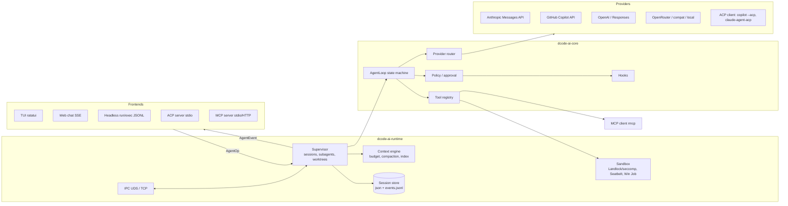

# dcode-ai v1 Master Plan — research, architecture, roadmap

Date: 2026-10-12 · Baseline: v0.0.43 (`64d75ce`) + uncommitted WIP on `main`
Primary providers (decided 2026-10-12): **Claude** and **GitHub Copilot**, both **OAuth sign-in only**
(no API-key onboarding):
- Claude → Anthropic Console OAuth through the official `ant` CLI (`ant auth login`, verified against ant v1.40.0).
  Claude.ai Pro/Max subscription login is **out** — Anthropic's terms bar third-party apps from it.
- Copilot → GitHub device-flow login (exists), with proper session-token refresh (M1b).
MiniMax/OpenCode Zen, OpenAI, OpenRouter, Antigravity, local stay supported but are secondary.

UI direction (decided 2026-10-12): **Hybrid** — inline/scrollback by default, `Ctrl+\` toggles a
full-screen dashboard (agents rail · transcript · diff/context panel). See §4.0.

> This plan builds on the existing 5-crate workspace (~69k LOC). It is **not** a rewrite.
> Earlier docs it supersedes in priority (all since removed, 2026-10-15): `docs/improvements-roadmap.md`,
> `feature-todo.md`, `TODO.md`, `COMPARISON_TABLE.md`, `MONOLITH_SPLITTING_PLAN.md`.

Legend for evidence: ✅ verified this session (source linked) · ◐ from prior knowledge, not re-verified
this session — check before quoting externally.

---

## 0. Where dcode-ai stands today (from the code)

| Area | State | Where |
|---|---|---|
| Agent loop | Multi-turn tool loop, parallel tool exec (`FuturesUnordered`), max turns / max tool calls per turn, cancel flag, mid-turn context trim, undo manager, hooks | `core/src/agent.rs` |
| Providers | `Provider` trait (`chat` → `mpsc::Receiver<StreamChunk>`), Anthropic, OpenAI (+Responses API, ChatGPT-OAuth backend, **Copilot via base_url hack**), OpenRouter, MiniMax, Antigravity/Vertex, `claude` CLI bridge, retry w/ backoff | `core/src/provider/` |
| Tools | read/write/edit/apply_patch/replace_match/rename/move/copy/delete, search (rg), list_dir, repo_map (PageRank), git status/diff, web search/fetch, code_intel (heuristic), validation runner, background exec, MCP (stdio + streamable HTTP), skills, ask_question, update_plan, spawn_subagent | `core/src/tools/` |
| Safety | 5 permission modes, structural command classifier, allow/ask/deny tiers, Landlock for bash (Linux), freshness write-guard, secret redaction | `core/approval.rs`, `core/command_safety.rs`, `runtime/sandbox.rs`, `common/redact.rs` |
| Context | o200k BPE estimate, auto-compact at 75% + overflow retry, preserved-artifacts block, Anthropic 3-breakpoint prompt caching, repo map in system prompt (opt-in) | `runtime/context_manager.rs`, `provider/anthropic_compat.rs` |
| Sessions | `<id>.json` + `<id>.events.jsonl`, resume/fork/replay/attach, schema version, lineage | `runtime/session_store.rs`, `supervisor/` |
| Multi-agent | Sub-agents with worktree isolation + parent/child lineage | `runtime/supervisor/subagent.rs`, `runtime/worktree.rs` |
| UX | ratatui TUI (inline viewport, scrolling regions), palette, themes, `@file`, image paste, `!cmd`, backtrack, notifications, web chat (`dcode-ai web`, SSE), VS Code bridge | `cli/src/tui/`, `cli/src/web_server.rs` |
| Headless | `run`, `spawn`, `attach`, `--json`, `--stream ndjson`, exit codes 0/1/10/11/13/130, IPC (UDS, length-prefixed) | `cli/src/main.rs`, `runtime/ipc.rs` |
| Extensibility | hooks (8 events), custom slash commands (`commands/*.md`), skills dirs (`.dcode-ai/skills`, `.claude/skills`), MCP client | `core/hooks.rs`, `core/skills.rs` |

### Defects found while writing this plan (fix first — Milestone 1)

**Claude path** (`provider/anthropic.rs`, `provider/anthropic_compat.rs`, `common/config.rs`):
1. `temperature` is always sent. On Opus 4.7+ / Opus 5 / Opus 5.5 / Sonnet 5 sampling params are **removed (400)**; on Sonnet 5.5 non-default values 400. → Default model choice breaks.
2. No `thinking` / `output_config.effort` in the request. Opus 5.5 always thinks but defaults to `display: "omitted"` → the TUI's `✦ thinking` stays empty and the user sees a long pause. `ModelConfig.enable_thinking/thinking_budget` are ignored for Anthropic. `budget_tokens` must **not** be sent to 4.7+ models.
3. `signature_delta` / thinking blocks are discarded; assistant turns are replayed without them. Thinking blocks must be echoed back unchanged within a tool loop on the same model.
4. Model IDs carry invented date suffixes (`claude-sonnet-4-6-20250514`, `claude-opus-4-8-20250520`) → 404. Current IDs are bare: `claude-opus-5-5`, `claude-sonnet-5-5`, `claude-haiku-5-5`, `claude-fable-5-1`.
5. Truncated/invalid `tool_use` JSON is silently dropped (`if let Ok(...)` in `flush_anthropic_tool_call`) → violates "fail loudly".
6. `stop_reason` (`max_tokens`, `refusal`) is not surfaced; refusals look like empty turns.
7. Default `max_tokens = 8192` truncates long edits; 4.6+ models allow 128K with streaming.
8. Mid-turn trimming / compaction rewrites earlier history. With preserved thinking (Opus 5.5, Sonnet 5.5; enforced for accounts created ≥ 2026-08-31) edited history invalidates thinking blocks → must strip thinking blocks from any message we rewrite, or keep history append-only.

**Copilot path** (`provider/openai.rs`, `cli/src/main.rs`, `cli/src/oauth_login.rs`):
1. Copilot is not a `ProviderKind`; it is `OpenAi` + `base_url = api.githubcopilot.com`, with `is_copilot_base_url` checks in ≥ 10 places. Switching OpenAI ↔ Copilot mutates shared config.
2. Copilot session token (`copilot_internal/v2/token`, ~25-30 min TTL ◐) is fetched **once** at provider build (blocking thread). Long sessions fail with 401; `CopilotAuth.copilot_token/expires_at` are never written or read.
3. Requests spoof VS Code (`User-Agent: GitHubCopilotChat/…`, `Editor-Version: vscode/1.90.0`, `Copilot-Integration-Id: vscode-chat`). This is a ToS / breakage risk (see §1.4). Make identity configurable and honest by default.
4. No live model catalog for Copilot (`GET {api}/models`), so `/models` can't list Claude/GPT/Gemini models available on the user's Copilot plan.
5. 404 fallback "use GitHub token directly" silently changes auth semantics — should be explicit error.

---

## Phase 1 — Competitive research (Oct 2026)

### 1.1 Status check of the requested list

| Tool | Status Oct 2026 | Notes |
|---|---|---|
| Claude Code | Active, v2.1.29x (Oct 8 2026) ✅ | subagents (background by default), agent teams, hooks, skills, plugins + marketplace, MCP, `/goal`, Agent View, remote control ✅ [releases.sh], [whats-new] |
| OpenAI Codex CLI (codex-rs) | Active, 0.15x alphas ✅ | exec JSONL events, `--approve-for-me` auto-review under workspace-write sandbox, plugin MCP (stdio/SSE/HTTP), Bedrock onboarding ✅ [techdevnotes] |
| Gemini CLI | **Retired** — replaced by Antigravity CLI (announced May 19 2026, consumer access ended Jun 18 2026) ✅ | Antigravity CLI is **Go**, closed source; keeps skills/hooks/subagents; extensions → "Antigravity plugins"; async background tasks ✅ [googleblog], [theregister] |
| GitHub Copilot CLI | GA (Feb 25 2026 ✅ — the prompt said April; changelog says Feb) | **ACP server** `copilot --acp [--stdio|--port]` (public preview) ✅; Actions without PAT (Jul 2026) ✅; separate app policy (Jul 27 2026) ✅ |
| Cursor CLI | Active ◐ | |
| Amp (Sourcegraph) | Active ◐ | thread sharing, oracle/subagents ◐ |
| Augment CLI (Auggie) | Active ◐ | context engine retrieval ◐ |
| Warp | **Client open-sourced Apr 2026 under AGPL-3.0** ✅ | AGPL → do not copy code into MIT dcode-ai |
| Kimi Code CLI | Kimi CLI being wound down in favour of Kimi Code ✅ [awesome-cli] | swarm features ◐ |
| Grok Build (xAI) | Open-source terminal agent, headless/CI mode ✅ (secondary sources) | |
| Rovo Dev CLI | Active ◐ | Jira/Confluence |
| Cline CLI 2.0 | Active ◐ | parallel agents, headless CI |
| OpenCode | Most-cited OSS alternative, MIT, ~165–202k★ ✅ | Crush (Charm) separate ◐ |
| Aider | Active ◐ | repo map, auto-commit, architect/editor |
| Qwen Code | Apache-2.0, Gemini-CLI fork ✅ | |
| Pi (Zechner/Ronacher) | "Most interesting new OSS entrant of 2026", 4 tools: read/write/edit/bash ✅ | |
| goose | Donated to Linux Foundation **Agentic AI Foundation** (Apr 2026), repo `aaif-goose/goose`, Apache-2.0 ✅ | |
| VT Code | Active, MIT, crates incl. `vtcode-acp` 0.141.x ✅ | |
| Zed ACP | Community-governed at `github.com/agentclientprotocol` ✅; Claude adapter `claude-agent-acp` (npm) ✅ | |

**New in the last ~3 months (Jul–Oct 2026) worth tracking:**
- **DeepSeek Harness (`dsh`)** — Aug 13 2026, MIT, "everything is a plugin incl. the loop" (single source ✅, verify).
- **Codewhale** (ex-deepseek-tui, Rust, ~41k★) — 30+ providers, headless `exec`, workspace snapshots, `/undo` ✅ [awesome-cli].
- **jcode** (Rust, ~20k★) — RAM/startup-optimized, many parallel sessions, swarm mode, 40+ providers ✅.
- **Maki** (Rust) — tree-sitter indexing, sandboxed code exec, **Lua plugins** ✅.
- **Tura** (Rust) — compiles a task into one command graph instead of a model round-trip per tool call ✅.
- **Smelt**, **Zap** (SQLite symbol index, skill-first context), **BitFun** (timeline undo/redo + Tauri), **Octomind** (tap registry), **Ferrum** (ACP + headless) ✅.
- Orchestrators: **herdr** (~42k★, agent multiplexer), **agent-of-empires** (tmux + worktrees), **hcom** (event bus across Claude Code/Codex/OpenCode) ✅.

**Excluded (leaked-source derived):** Claw Code, claw-code-agent, Claurst ✅ [awesome-cli marks them as born from the Mar 2026 Claude Code source leak]. Do not read or borrow.

### 1.2 Feature matrix (tool × feature)

✓ strong · ~ partial · ✗ none · ? unknown. Mostly ◐ unless the row/column is marked.

| Feature | Claude Code | Codex CLI | Copilot CLI | Antigravity CLI | OpenCode | Aider | goose | VT Code | Pi | **dcode-ai now** |
|---|---|---|---|---|---|---|---|---|---|---|
| Plan/build modes | ✓ | ✓ | ✓ | ✓ | ✓ | ✓ (architect) | ~ | ✓ | ✗ | ✓ (plan mode + profiles) |
| Patch-style edits | ✓ str_replace | ✓ apply_patch | ✓ | ✓ | ✓ | ✓ diff fmts | ✓ | ✓ | ✓ | ✓ (edit/apply_patch/replace) |
| LSP / AST tools | ~ (plugins) | ✗ | ~ | ? | ✓ LSP | ✗ | ~ | ✓ ast-grep | ✗ | ~ heuristic |
| Repo map | ✗ (agentic search) | ✗ | ✗ | ? | ✗ | ✓ PageRank | ✗ | ✓ | ✗ | ✓ PageRank (opt-in) |
| Auto-compaction | ✓ | ✓ | ✓ | ✓ | ✓ | ~ | ✓ | ✓ | ~ | ✓ |
| Memory file | CLAUDE.md | AGENTS.md | AGENTS.md + copilot-instructions | GEMINI.md→? | AGENTS.md | CONVENTIONS | .goosehints | AGENTS.md | AGENTS.md | AGENTS.md, .dcode-airc, memory.json |
| OS sandbox | ✓ (Seatbelt/bwrap) | ✓ Landlock+seccomp / Seatbelt | ~ | ? | ✗ | ✗ | ✗ | ✓ | ✗ | ~ Landlock bash only |
| Approval modes | ✓ + auto mode | ✓ + auto-review ✅ | ✓ | ✓ | ✓ | ~ | ✓ | ✓ | ✗ (yolo) | ✓ 5 modes |
| Providers | Anthropic (+Bedrock/Vertex/Foundry) | OpenAI (+OSS, Bedrock ✅) | multi via Copilot + BYOK ✅ | Gemini | 75+ | 100+ (litellm) | many | many | many | 7 kinds |
| MCP client | ✓ | ✓ | ✓ | ✓ | ✓ | ~ | ✓ (MCP-first) | ✓ | ✗ | ✓ stdio+HTTP |
| MCP server mode | ✓ | ✓ | ? | ? | ✗ | ✗ | ✗ | ✓ | ✗ | ✗ |
| ACP | via adapter ✅ | via adapter / Zed ✅ | **native server** ✅ | ? | ✓ | ✗ | ✓ | ✓ ✅ | ✗ | ✗ |
| Skills | ✓ | ✓ | ✓ | ✓ ✅ | ✓ | ✗ | ✓ recipes | ✓ | ~ | ✓ |
| Hooks | ✓ | ~ | ✓ | ✓ ✅ | ✓ plugins | ✗ | ~ | ✓ | ✓ ext | ✓ 8 events |
| Plugins/marketplace | ✓ ✅ | ✓ plugin list ✅ | ✓ | ✓ ✅ | ✓ | ✗ | ✓ | ~ | ✓ npm ext | ✗ |
| Subagents | ✓ background ✅ | ✓ | ✓ | ✓ ✅ | ✓ | ✗ | ✓ | ✓ propose/verify | ✗ | ✓ |
| Worktree isolation | ✓ | ✓ | ? | ? | ~ | ✗ | ✗ | ✓ | ✗ | ✓ |
| Headless JSONL | ✓ stream-json | ✓ exec JSONL ✅ | ✓ | ✓ | ✓ | ✓ | ✓ | ✓ | ✓ RPC | ✓ ndjson |
| Checkpoints/undo | ✓ rewind | ~ | ? | ? | ✓ | ✓ git | ✗ | ✓ | ✗ | ✓ /undo /redo + backtrack |
| Auto-commit / PR | ~ (gh) | ~ | ✓ native GitHub ✅ | ? | ~ | ✓ auto-commit | ✗ | ~ | ✗ | ✗ |
| Cost tracking | ✓ /cost | ~ | ~ premium reqs | ? | ✓ | ✓ | ~ | ✓ guardrails | ✓ | ✓ CostTracker |
| Web UI / IDE | IDE ext + web | IDE + cloud | IDE + github.com | desktop/IDE | TUI + web + desktop | ✗ | desktop | VS Code | ✗ | web chat + VS Code bridge |

### 1.3 Rust implementation comparison (section C)

| | **codex-rs** | **goose** | **VT Code** | **Codewhale/jcode/Maki** (new) | **dcode-ai** |
|---|---|---|---|---|---|
| Licence | Apache-2.0 | Apache-2.0 | MIT | check per repo | MIT |
| Workspace | many crates: `core`, `tui`, `exec`, `exec-server`, `linux-sandbox`, `apply-patch`, `mcp-client`, `mcp-server`, `protocol`, `login`… ◐ | `goose` (core), `goose-cli`, `goose-server`, `goose-mcp` ◐ | `vtcode-core`, `vtcode-acp`, `vtcode-config`, … ✅ | mixed | 5 crates |
| Async | tokio | tokio | tokio | tokio | tokio |
| TUI | ratatui + crossterm | (CLI, cliclack) / desktop Electron | ratatui | ratatui | ratatui 0.30 + crossterm 0.29 |
| Protocol boundary | `protocol` crate: Op/Event queue (SQ/EQ) between UI and core ◐ | REST/SSE server for desktop | ACP | — | `AgentEvent` bus + IPC |
| Sandbox | Landlock + seccomp (Linux), Seatbelt (macOS), restricted token (Windows) ◐ | none | Landlock/Seatbelt ◐ | Maki: sandboxed exec | Landlock (bash only) |
| MCP | own client + server | `rmcp` (official Rust SDK) ◐ | client + server | | `mcpr` + hand-rolled HTTP |
| Edit format | `apply_patch` (`*** Begin Patch`) | str_replace style | ast-grep + patch | | both |

**What to borrow (licences compatible — Apache-2.0/MIT, keep NOTICE attribution):**
1. codex-rs **SQ/EQ protocol split**: a typed `Op` (UI → agent) / `Event` (agent → UI) pair. dcode-ai already has `AgentEvent`; add a symmetric `AgentOp` and route TUI, web, IPC, ACP through it (one boundary for all front-ends).
2. codex-rs **seccomp + Landlock** policy layering and **Seatbelt** profile approach for macOS.
3. codex-rs `exec --json` event schema discipline (versioned, documented).
4. goose/`rmcp`: replace `mcpr` (0.2, small) with the official **`rmcp`** SDK for MCP client *and* server.
5. VT Code: ACP server crate shape, propose/verify subagent split, cost guardrails.
6. Tura idea: batch deterministic tool chains (read N files) without a model round-trip.

### 1.4 Provider policy facts that shape the design

- **Anthropic** (Oct 2026, secondary sources ✅, verify on Anthropic Legal page): third-party apps may not offer Claude.ai login or route through Free/Pro/Max plans. → dcode-ai signs in with **Anthropic Console OAuth via `ant`** (Anthropic's own OAuth client; tokens are short-lived and refreshed by `ant auth print-credentials`). The previous flow that reused Claude Code's OAuth client ID to mint API keys is **removed** (M1, done). The silent `claude` CLI fallback is removed from the provider factory; `ClaudeCliProvider` stays in-tree only for a future explicit ACP/bridge mode.
- **Copilot**: official surfaces are the Copilot CLI (with an **ACP server**) and Copilot SDK/BYOK. Direct use of `api.githubcopilot.com` from third-party clients is undocumented (◐); the endpoint and token exchange may change. → Ship a first-class Copilot provider but (a) isolate it behind one module, (b) refresh tokens properly, (c) fail loudly with actionable errors, (d) make client identity configurable, (e) plan the **ACP-client fallback** (`copilot --acp --stdio`) as the officially supported path (Milestone 4).

### 1.5 Ranked features for dcode-ai

**Must-have (v1.0)**
1. Correct, current Claude provider (thinking, effort, signatures, refusal, model IDs) — *bug-level*.
2. First-class Copilot provider with token refresh + live model catalog.
3. Provider-agnostic `ProviderKind::Copilot` + model routing (`copilot/claude-sonnet-5-5`, `anthropic/claude-opus-5-5`).
4. MCP via `rmcp` (client) + **MCP server mode** (expose dcode-ai tools/sessions to Claude Code & Copilot CLI).
5. OS sandbox parity: Landlock+seccomp for *all* exec tools on Linux, Seatbelt on macOS, Windows restricted-token/Job object.
6. Policy-as-code permissions (`.dcode-ai/policy.toml`, rule order, path + command + network rules).
7. Checkpoints (git-backed shadow repo) + `/rewind` covering files and conversation.
8. Finish the `app.rs` / `repl.rs` split (blocks every UX feature).
9. Headless CI mode with stable, versioned JSONL schema + GitHub Action.

**Should-have (v1.x)**
10. ACP server (Zed, JetBrains, Neovim) and ACP client (drive `copilot --acp`, `claude-agent-acp`).
11. Tree-sitter symbol index (incremental, on-disk) feeding repo map + `find_symbol` tool.
12. Propose/verify subagents in worktrees with merge queue.
13. Plugins (bundle of skills + commands + hooks + MCP servers) with `dcode-ai plugin install <git-url>`.
14. Native GitHub integration (issues/PRs/review comments) using `gh` or REST with the Copilot/GitHub token.
15. Per-hunk accept/reject diff review.
16. Cost/token budgets with hard stop + live gauge (per session, per subagent tree).

**Nice-to-have**
17. Deterministic replay (record provider streams; replay offline).
18. Optional embeddings (local, `fastembed`/ONNX) for semantic search.
19. A2A protocol.
20. Lua/WASM plugin runtime (Maki-style) — only after plugin manifest is stable.

---

## Phase 2 — Differentiating features

| Feature | User problem | Why dcode-ai can win |
|---|---|---|
| **Provider-routed roles** — `planner = anthropic/claude-opus-5-5`, `worker = copilot/gpt-…`, `verifier = copilot/claude-sonnet-5-5` | Users pay for both Claude API and Copilot; no tool lets them mix both per role | Copilot premium requests are pre-paid; route cheap/bulk worker turns to Copilot, hard reasoning to Claude API |
| **Verifier-gated parallel worktrees** | Parallel agents produce conflicting, unverified diffs | Supervisor + worktrees + lineage already exist; add verifier stage + merge queue |
| **Budget guardrails** (tokens + $ + Copilot premium requests) per session tree, with hard stop and `/cost` breakdown by role/provider | Surprise bills; runaway subagents | `CostTracker` exists; extend to subagent trees and Copilot request multipliers |
| **Deterministic replay** (`dcode-ai replay --offline <id>`) | Can't debug "why did the agent do that" | Events JSONL already persisted; add raw provider stream capture + tool result capture |
| **Rust-speed incremental index** (tree-sitter + `ignore` walker, mmap'd, <100 ms warm) | Repo maps are slow/stale on big monorepos | Native, no Node; index shared across parallel agents |
| **Policy-as-code** (`policy.toml`, testable with `dcode-ai policy test`) | Teams can't audit/approve agent permissions | Structural command classifier already exists |
| **ACP both ways** | Editor lock-in; can't reuse Copilot CLI/Claude Code subscriptions inside one orchestrator | dcode-ai as ACP *server* (editors) and ACP *client* (drive official CLIs as sub-agents) |
| **CI-native headless** (`dcode-ai ci --task review|fix-tests|triage`) | Agents in CI need deterministic exit codes, budgets, artifacts | Exit codes + NDJSON exist; add GitHub Action + SARIF/markdown artifacts |
| **Offline-first** (Ollama/llama.cpp + local index) | Air-gapped / privacy | `/connect ollama|lmstudio|vllm` exists |

---

## Phase 3 — Architecture

### 3.1 High-level diagram



### 3.2 Crate layout — evolve, don't explode

The prompt suggests ~11 crates. Recommendation: **split only where a boundary already hurts compile times or has a second consumer.** Today `cli` (~25k LOC incl. `app.rs` 5k, `repl.rs` 5.4k) and `core` are the hot spots.

| Crate | Status | Responsibility / public API |
|---|---|---|
| `dcode-ai-common` | keep | config tree, `Message`, `ToolCall/Result`, `AgentEvent`, **new `AgentOp`**, auth/credentials, redaction. No I/O beyond config files. |
| `dcode-ai-providers` | **new (M2)** — moved out of `core/provider` | `trait Provider`, `ProviderRouter`, `ModelRef {provider, model}`, Anthropic, Copilot, OpenAI, compat, retry, model catalogs. Lets ACP/MCP servers & benches depend on providers without the agent. |
| `dcode-ai-core` | keep | `AgentLoop`, tools, approval/policy, hooks, skills, undo |
| `dcode-ai-sandbox` | **new (M3)** — from `runtime/sandbox.rs` | `trait Sandbox { fn wrap(&self, cmd: &mut Command, policy: &SandboxPolicy) }`; Linux (landlock+seccompiler), macOS (sandbox-exec profile), Windows (Job object + restricted token) |
| `dcode-ai-index` | **new (M4)** — from `core/code_map.rs`, `code_intel.rs` | tree-sitter symbol index, repo map ranking, file watcher |
| `dcode-ai-protocol` | **new (M4)** | ACP server + client, MCP server (rmcp), JSONL exec schema |
| `dcode-ai-runtime` | keep | supervisor, sessions, IPC, PTY, context manager, worktrees |
| `dcode-ai-cli` | keep, split internally | TUI/REPL/web/headless; finish `app.rs` split |
| `dcode-ai-autoresearch` | decide | integrate as `dcode-ai research` or archive (TODO.md item) |

### 3.3 Agent loop state machine

```mermaid
stateDiagram-v2
  [*] --> Idle
  Idle --> Preparing: AgentOp::UserTurn
  Preparing --> Streaming: build request (system+history+tools, cache breakpoints)
  Streaming --> Streaming: Text/Thinking/ToolUse deltas
  Streaming --> Dispatching: stop_reason=tool_use
  Streaming --> Done: stop_reason=end_turn
  Streaming --> Recovering: transient error / overflow / max_tokens
  Streaming --> Failed: refusal / auth / empty completion
  Dispatching --> AwaitApproval: policy=ask
  AwaitApproval --> Dispatching: approved
  AwaitApproval --> Preparing: denied (tool_result is_error)
  Dispatching --> Preparing: all tool_results appended (single user msg)
  Recovering --> Preparing: retry / compact / continue
  Recovering --> Failed: retries exhausted
  Idle --> Cancelled: Ctrl+C
  Streaming --> Cancelled: Ctrl+C (drop stream, keep partial text)
  Dispatching --> Cancelled: Ctrl+C (kill process group)
  Done --> Idle
  Failed --> Idle
  Cancelled --> Idle
```

Guards: `max_turns`, `max_tool_calls_per_turn`, **budget guard** (tokens/$/premium requests), identical-call loop detector (same tool+args N times), wall-clock timeout per tool.
Plan vs build: plan mode = read-only registry + `update_plan`; `/plan → build` handoff writes `.dcode-ai/plans/<ts>.md` and starts a build turn seeded with it.

Rust note (for a TS background): the loop owns `Vec<Message>` (`&mut self`), so there is no shared mutable state to lock; tools get `&ToolCall` and return owned `ToolResult`. Concurrency comes from `FuturesUnordered` over `async fn execute(&self, …)` — tools must be `Send + Sync` so they can run on any Tokio worker thread. Cancellation is cooperative (`AtomicBool` + `tokio::select!` on a `CancellationToken`), not exceptions.

### 3.4 Multi-agent orchestration

```mermaid
sequenceDiagram
  participant U as User
  participant P as Planner (anthropic/opus-5-5)
  participant S as Supervisor
  participant W1 as Worker A (worktree)
  participant W2 as Worker B (worktree)
  participant V as Verifier (copilot/sonnet-5-5)
  U->>P: task
  P->>S: spawn_subagent x2 (spec, files, budget)
  S->>W1: create worktree, child session (lineage)
  S->>W2: create worktree, child session
  W1-->>S: diff + summary + test result
  W2-->>S: diff + summary + test result
  S->>V: verify(diff, spec, tests) in clean worktree
  V-->>S: pass/fail + findings
  S->>P: results; P merges via merge queue (rebase, rerun tests)
  P-->>U: summary + /diff to review
```

### 3.5 Provider abstraction (target)

```rust
/// What the agent asks for; providers translate it.
pub struct ChatRequest<'a> {
    pub model: &'a str,
    pub messages: &'a [Message],          // includes replayable ProviderBlocks
    pub tools: &'a [ToolDefinition],
    pub max_tokens: u32,
    pub reasoning: Reasoning,             // Off | Adaptive { effort, display }
    pub cache: CacheHints,                // where breakpoints may go
    pub workspace_root: &'a Path,
}

pub enum StreamChunk {
    TextDelta(String),
    InternalDelta(String),
    /// Opaque block the provider needs echoed back verbatim next request
    /// (Anthropic thinking+signature, OpenAI encrypted reasoning items).
    ReplayBlock(serde_json::Value),
    ToolUse(ToolCall),
    Usage(Usage),                         // input/output/cache read/write, premium requests
    Stop(StopReason),                     // EndTurn | ToolUse | MaxTokens | Refusal{category}
    Error(String),
    Done,
}

#[async_trait]
pub trait Provider: Send + Sync {
    fn id(&self) -> ProviderKind;
    fn capabilities(&self, model: &str) -> ProviderCapabilities;
    async fn list_models(&self) -> Result<Vec<ModelInfo>, ProviderError>;
    async fn chat(&self, req: ChatRequest<'_>)
        -> Result<tokio::sync::mpsc::Receiver<StreamChunk>, ProviderError>;
}
```

Per-provider quirks live in one module each. Credentials that expire (Copilot session token, OpenAI OAuth, Vertex) use a shared `TokenSource` with `async fn token(&self) -> Result<Secret>` that caches + refreshes under a `tokio::sync::Mutex` (single-flight) and is called **per request**, not at construction.

### 3.6 Tool system

Keep `ToolExecutor { definition(); execute() }`. Add:
- `fn tier(&self) -> PermissionTier` and `fn side_effects(&self) -> SideEffects { reads: Vec<PathPattern>, writes, network, exec }` so policy can reason structurally.
- Schema generation via `schemars` derive on typed args structs (removes hand-written JSON schema drift); validate input against schema before execute (needed for Anthropic eager input streaming).
- `ToolRegistry` → `HashMap<String, Arc<dyn ToolExecutor>>` (current linear scan calls `definition()` per lookup).
- Output truncation: head+tail with a `…N lines elided, use read_file offset=…` marker; already 24k cap — make it token-based per model.

### 3.7 Context engine
- Exact counts: Anthropic `count_tokens`, otherwise BPE estimate (existing).
- Repo map v3: tree-sitter definitions/references (`tree-sitter` + language grammars, `ignore` walker) → PageRank (existing) personalized toward files mentioned in the turn (Aider's trick).
- Compaction: keep current summary + preserved-artifacts, **append-only for Claude** (insert compaction as new messages; strip thinking blocks only from rewritten messages). Optionally use Anthropic server-side compaction beta when on Anthropic.

### 3.8 Sandbox & security
| OS | Mechanism | Crate |
|---|---|---|
| Linux | Landlock (fs) + seccomp (deny `socket` for no-network) | `landlock` (have), `seccompiler` |
| macOS | `sandbox-exec` with generated SBPL profile (as codex-rs) | std `Command` |
| Windows | Job object (kill-on-close, limits) + restricted token / AppContainer | `windows` crate |
Modes map: suggest = default, auto-edit = accept-edits, full-auto = dont-ask/bypass **inside** sandbox. Secrets: existing `redact.rs` on tool output + event log; never log `Authorization` headers.

### 3.9 Sessions & persistence
Keep JSONL (append-only, greppable, streaming-friendly). Add a **SQLite index** (`rusqlite`, bundled) only for search/listing across sessions (`/resume` picker, cost history). Checkpoints: shadow git repo at `.dcode-ai/checkpoints/<session>` (commit per turn that wrote files) → `/rewind` restores files + truncates conversation.

### 3.10 Protocols
- MCP client: migrate `mcpr` → `rmcp` (stdio, streamable HTTP, OAuth).
- MCP server: `dcode-ai mcp serve` exposing `spawn_session`, `session_status`, `repo_map`, `find_symbol`, `worktree_*` so **Claude Code and Copilot CLI can call dcode-ai** as a tool.
- ACP server: `dcode-ai acp` (stdio) for Zed/JetBrains/Neovim.
- ACP client: `ProviderKind::Acp { command }` backend that drives `copilot --acp --stdio` or `claude-agent-acp` as a sub-agent.
- A2A: defer.

### 3.11 Extensibility
Plugin = directory/git repo with `dcode-plugin.toml` listing `skills/`, `commands/`, `hooks`, `mcp_servers`. Install to `~/.dcode-ai/plugins/<name>`, enabled per workspace. Compatible readers for `.claude/skills` and `.github/copilot-instructions.md` / `AGENTS.md`.

### 3.12 Config
Already layered (defaults → global → workspace → env → flags). Add: `[[routes]]` for role→model, `[provider.copilot]`, `[provider.anthropic] effort/thinking_display`, `[budget]`, and `dcode-ai config validate` (unknown-key warnings via `serde(deny_unknown_fields)` in a validation pass).

### 3.13 Concurrency
Tokio multi-thread runtime. UI ↔ supervisor via bounded `mpsc` (`AgentOp`) + `broadcast` (`AgentEvent`) — lagging consumers already get "N events skipped". Provider stream channel bounded (64) gives natural backpressure to the HTTP body reader.

### 3.14 Observability
`tracing` spans per session/turn/tool (`session_id`, `turn`, `tool`), `--debug` writes `~/.dcode-ai/logs/<session>.log` (JSON), `DCODE_AI_LOG=…` env filter. Opt-in telemetry only, off by default.

### 3.15 Testing
- Unit + proptest (exists). Mock providers via `test_support::spawn_sse_server` (exists) — add recorded **fixtures per provider** (Anthropic thinking+tool loop, Copilot 401→refresh).
- TUI snapshots: `insta` + ratatui `TestBackend` (exists).
- E2E evals: `evals/` with ~30 small repos/tasks, run headless with budget cap, score = tests pass; nightly on CI with a cheap model.

### Recommended crates
`tokio`, `reqwest` (rustls), `serde`/`serde_json`, `schemars`, `clap`, `ratatui`/`crossterm`, `tree-sitter` (+ `tree-sitter-{rust,ts,python,go,…}`), `ast-grep-core` (MIT), `ignore` + `grep-searcher` (ripgrep internals, MIT/Unlicense), `rmcp`, `agent-client-protocol` (check crate name/version on crates.io), `rusqlite` (bundled), `landlock`, `seccompiler`, `similar`, `tiktoken-rs`, `insta`, `keyring` (later).

---

## Phase 4 — UI/UX

### 4.0 Hybrid mode (decided)

- **Inline (default):** today's scrollback-preserving viewport, restyled — tool calls as compact cards
  (`⚡ edit src/auth.rs ✓ +12 −3`), collapsible thinking summary, one-line status bar.
- **Dashboard (`Ctrl+\`):** alternate screen, three panes; each pane toggles independently
  (`Ctrl+1/2/3`), state lives in `TuiSessionState`, so switching modes never loses transcript or input.

```
┌ agents ──────┬ transcript ────────────────────────────┬ diff · plan · context ┐
│● main  opus  │ ✦ Thought 4s · planning auth fix        │ src/auth.rs  2 hunks  │
│ ├ worker gpt │ ⚡ edit src/auth.rs ✓ +12 −3            │ ✔ @@ -38,7 +38,7 @@   │
│ └ verify son │ Fixed the off-by-one in token expiry.   │ ✘ @@ -90,4 +90,9 @@   │
│○ refactor    │                                         │ plan ☑ read ☐ test    │
│              ├─────────────────────────────────────────┤ ctx ▰▰▱▱ 38%  $0.42  │
│ [n]ew [k]ill │ > _                                     │ copilot 12/300 prem   │
└──────────────┴─────────────────────────────────────────┴───────────────────────┘
 claude/opus-5-5 · high · main ↑2 · accept-edits · Ctrl+\ inline
```

Implementation order: (1) finish `app.rs` run-loop split so key handling maps to intents;
(2) `ViewMode` + layout skeleton with `insta` snapshots; (3) agents rail fed by supervisor
lineage events; (4) side panel tabs (diff review per-hunk, plan, context/cost); (5) inline restyle.

### 4.1 Main layout (inline viewport, scrollback above)

```
 ✦ thinking  planning edit to src/auth.rs …                                 (dim, collapsible)
 ⚡ read_file src/auth.rs  ✓ 212 lines
 ⚡ edit_file src/auth.rs  ✓ +12 −3
   │ 41 │-    if token.exp < now {
   │ 41 │+    if token.exp <= now {
 Assistant: Fixed the off-by-one in expiry …
┌ subagents ──────────────────────────────────────────────────────────────────┐
│ ● worker-a  copilot/gpt-5    fix tests       12.4k tok  $0.00 (1 prem req)  │
│ ◐ verifier  copilot/sonnet   verifying…                                     │
└─────────────────────────────────────────────────────────────────────────────┘
╭─ @build ─────────────────────────────────────────────────────────────────────╮
│ > _                                                                          │
╰──────────────────────────────────────────────────────────────────────────────╯
 anthropic/claude-opus-5-5 · effort high · ctx ▰▰▱▱▱ 38% · $0.42 · main ↑2 · accept-edits
```

### 4.2 Approval prompt
```
╭ approve: execute_bash ───────────────────────────────────────────────╮
│ cargo test -p dcode-ai-core                                          │
│ sandbox: workspace-write, network: off                               │
│ [y] once  [a] always for `cargo test *`  [n] deny  [e] edit  [?] why │
╰──────────────────────────────────────────────────────────────────────╯
```

### 4.3 Per-hunk diff review (`/diff`)
```
 src/auth.rs  (2 hunks)                                   [j/k] hunk  [space] toggle
 ✔ @@ -38,7 +38,7 @@ fn validate                           [a] accept all [r] reject
 ✘ @@ -90,4 +90,9 @@ fn refresh                           [enter] apply  [q] quit
```

### 4.4 Slash commands (target set; ✓ = exists)
`/model ✓ /models ✓ /provider ✓ /connect ✓ /plan (→ build) /compact ✓ /undo ✓ /redo ✓ /rewind /diff ✓ /review ✓ /cost /budget /init ✓ /resume ✓ /sessions ✓ /fork ✓ /agents /mcp /plugins /permission ✓ /policy /theme ✓ /memory ✓ /doctor ✓ /login /logout /copilot (quota) /effort`

### 4.5 Keys / themes / accessibility
Existing: Ctrl+P palette, F2 model cycle, Tab profile, Esc cancel/backtrack, Ctrl+V image. Add: Ctrl+T effort cycle, Ctrl+O toggle thinking, Ctrl+G open diff review. `NO_COLOR` and `--plain` (no TUI, line-oriented, screen-reader friendly), high-contrast theme.

### 4.6 Onboarding (first run)
1. Detect: `ANTHROPIC_API_KEY`, `gh auth token`/Copilot login, `OPENAI_API_KEY`, local Ollama.
2. Offer **Claude (API key)** and **GitHub Copilot (device login)** first; others under "More".
3. Validate live (`doctor --check` probe), pick default model from the live catalog.
4. Offer `/init` to write AGENTS.md.

---

## Phase 5 — Roadmap

| Milestone | Scope | Size | Depends on |
|---|---|---|---|
| **M1a — Claude correctness + OAuth** ✅ done 2026-10-12 | `ant` OAuth credential source (bearer + `oauth-2025-04-20`, 5-min reuse, force-refresh + retry on 401), `ANTHROPIC_AUTH_TOKEN` support, TUI `/login anthropic` drives `ant auth login --no-browser` through the existing paste-code modal; model-aware request shape (`ClaudeFamily`): no sampling on 4.7+/5.x, adaptive thinking `display: summarized`, `output_config.effort` (default `high`), budgeted thinking for legacy; thinking blocks + signatures captured (`StreamChunk::ReplayBlock` → `Message::provider_blocks`) and replayed, stripped on compaction/trim; `StreamChunk::Stop` (refusal fails loudly, `max_tokens` mid-tool-call fails loudly); truncated tool JSON → loud error; SSE `error` events surfaced; 64K `max_tokens` floor on adaptive models; current model IDs/aliases/pricing/context limits; onboarding lists Claude + Copilot first. | M | — |
| **M1b — Copilot first-class** ✅ done, live-tested 2026-10-13 (GitHub token used directly; internal token exchange is 403-blocked for third-party clients) | `ProviderKind::Copilot` (+ config migration from `openai.base_url` hack), `CopilotTokenSource` with expiry-aware refresh persisted to `CopilotAuth.copilot_token/expires_at`, 401 → refresh + retry, live `/models` catalog, explicit errors (no silent GitHub-token fallback), configurable client identity, remove `is_copilot_base_url` callers | M | — |
| **M1c — Hybrid UI foundation** ✅ done 2026-10-13 | `app.rs` split (5,033 → ~1.8k lines: app/{frame,keys,mouse,dashboard}.rs); `ViewMode::{Inline, Dashboard}`; `Ctrl+\` (also legacy `Ctrl+4`) and `/dashboard` toggle; dashboard on the alternate screen with session rail (model, profile, agents + sub-agents), centre session pane (full transcript, composer pinned bottom, status bar) and context rail (plan, usage, ctx gauge); adaptive columns (≥120 both rails, ≥90 context only); scrollback flushing paused in dashboard and caught up on return; wheel/PageUp/PageDown scroll; snapshot + unit tests; live-tested in tmux. Follow-ups landed in M1d | M | — |
| **M1d — Dashboard panels + Copilot Responses** ✅ done, live-tested 2026-10-13 | Copilot: route models served only on `/responses` (codex family, from `GET /models` `supported_endpoints`, cached per provider) through the Responses API; stream keyed by `output_index` (Copilot obfuscates `item_id` per event), no duplicate text from `output_text.done`, `response.failed`/`incomplete` surfaced, no `temperature`, reasoning summary requested; dead non-streaming / ChatGPT-backend code removed. Dashboard: right rail tabs **context · changes** — `Ctrl+D` opens/focuses *changes*: unstaged + untracked files from git, hunks vs the index, `j/k` select, `r r` reverts one hunk (rewrites the file from the index + the other hunks via `diff_hunk::apply_selected_hunks`), `g` refresh, auto-refresh after each turn, `Esc` back to composer. Mouse: transcript click targets (question options, copy, thinking/assistant toggles, links) via rects recorded at draw time, rail tab clicks, hunk clicks, sub-agent row click → agent picker on that row (`Enter` attaches). Also: `run --stream human` no longer prints a streamed assistant reply twice after tool turns. | M | M1c |
| **M7a — Claude-style UX, `/rewind` with code, plan → build** ✅ done, live-tested 2026-10-14 | See [2026-10-14-claude-style-ux.md](2026-10-14-claude-style-ux.md): `> ` / `⏺` / `⎿` transcript grammar, Claude tool names, todo checklist, welcome box, `✻ Verb… (Ns · ↓ tokens · esc to interrupt)` spinner, `? for shortcuts` / mode footer, Shift+Tab mode cycle, permission / rewind / plan prompts in place of the composer, Esc Esc rewind restoring files from per-turn snapshots, plan-mode turns end in *Ready to code?*, `claude` default theme | M | M1c |
| **M8a — Plugins, MCP files, resume** ✅ done, live-tested 2026-10-14 | See [2026-10-14-extensibility-sessions.md](2026-10-14-extensibility-sessions.md): Claude Code-compatible `.mcp.json` (local/project/user) + `dcode-ai mcp add/get/remove`; plugins (Claude Code layout: commands, skills, MCP, hooks; marketplace install) via `dcode-ai plugin …` and `/plugins`; namespaced command files + `$1…$9`; `-c/--continue`, `-r <id or suffix>`; rewinds persisted to the event log; `# note` memory; loud failure on malformed OpenAI-style tool JSON; quiet stderr logging | M | M7a |
| **M8b — Custom agents, Copilot Messages API** ✅ done, live-tested 2026-10-14 | Claude Code-format agent definitions (`.dcode-ai/agents`, `.claude/agents`, plugin `agents/`; tools mapped to dcode-ai tools, model alias handling per provider) offered through `spawn_subagent.agent`, child runs with restricted tool registry + agent instructions; `/agents` lists them. Copilot: Claude models use `/v1/messages` (adaptive thinking, signatures, caching; output cap from `/models` limits), `reasoning_effort` for models that advertise it | M | M8a |
| **M8c — UX polish** ✅ done 2026-10-14 | `/context` usage grid + breakdown (system / tools / conversation / free), `/effort low…max` drives Claude effort and Copilot reasoning effort without shrinking `max_tokens`, `?` on an empty prompt opens shortcuts (new Essentials section), typed `/command` shown in the transcript instead of its expanded template, info dialogs size to their content | S | M8b |
| **M8d — Turn hooks, status line, MCP serve, budget** ✅ done, live-tested 2026-10-14 | See [2026-10-14-m8d-hooks-statusline-mcp-serve.md](2026-10-14-m8d-hooks-statusline-mcp-serve.md): `user_prompt_submit` (blocking) and `stop` hooks (+ plugin `UserPromptSubmit`/`Stop`), `[ui] statusline_command`, `dcode-ai mcp serve [--allow-writes]`, `[session] max_cost_usd` | M | M8c |
| **M8e — Plugin marketplaces + `/plugins` browser** ✅ done, live-tested 2026-10-14 | See [2026-10-14-m8e-plugin-browser.md](2026-10-14-m8e-plugin-browser.md): marketplaces (official added on first open; relative / github / url / git-subdir sources; `strict:false`), `name@market` installs, `plugin marketplace …` / `plugin search`, TUI browser (Discover · Installed · Marketplaces · Errors), command files' `` !`cmd` `` + scoped `allowed-tools`, command files hidden from the model's skill list, `.dcode-ai/.gitignore` for private state | M | M8d |
| **M8f — Gaps, themes, routing, CI** ✅ done 2026-10-14 | live plugin reload (`/reload`, tolerant MCP loading), dashboard agents tab, resume restores provider, `pre_compact` hook, sessions `--all`, scoped command `model:`, Copilot `oauth_client_id`, install.sh provider checks, `--plain`, Claude theme set + picker, `[model] compact_model` / `subagent_model`, `dcode-ai ci` + GitHub Action (`action.yml`) | M | M8e |
| **M4a — ACP server** ✅ done, live-tested 2026-10-14 | `dcode-ai acp`: initialize, session/new, session/prompt with session/update (message/thought chunks, tool_call/tool_call_update, plan), session/cancel, approvals via session/request_permission; prompt text/resource_link/resource blocks. Not yet: loadSession, client fs/terminal capabilities, images | M | M8f |
| **M9 — Language servers, policy + Seatbelt, verifier** ✅ done 2026-10-15 | See [2026-10-14-m9-safety-index-verify.md](2026-10-14-m9-safety-index-verify.md): LSP chosen by project (built-ins, `.lsp.json`, plugin `lspServers`); `ask` rules enforced, `policy.toml` files, `dcode-ai policy show|test`; macOS `sandbox-exec` Seatbelt profile for `sandbox_bash`; `/verify` read-only verifier + `verify_after_edits`; also markdown wrapping fix, resume model/provider guard, in-place sub-agent activity line | M | M8f |
| **M10 — Claude input box, image chips, inspect_binary** ✅ done 2026-10-15 | See [2026-10-15-m10-claude-input-inspect-binary.md](2026-10-15-m10-claude-input-inspect-binary.md): rule-style prompt (pink `!` mode), `[Image #N]` / `[Pasted text #N +L lines]` chips deleted as one unit, `●` bullet that blinks while a tool runs, Copilot vision requests, Rust-native `inspect_binary` (REA-inspired) | M | M9 |
| **M11 — Background shells** ✅ done 2026-10-15 (v1.0.3) | See [2026-10-15-m11-background-shells.md](2026-10-15-m11-background-shells.md): job events, footer badge, turn summary, automatic wake-up, `/bashes`, bypass without prompts | M | M10 |
| **M12 — Claude parity batch** ✅ done 2026-10-15 (v1.0.4) | See [2026-10-15-m12-claude-parity-batch.md](2026-10-15-m12-claude-parity-batch.md): Ctrl+B background, thinking keywords, output styles, session cleanup | M | M11 |
| **M13 — MCP tool search** ✅ done 2026-10-15 | See [2026-10-15-m13-mcp-tool-search.md](2026-10-15-m13-mcp-tool-search.md): deferred MCP tools above `tool_search_threshold`, loaded on demand; also `/release-notes`, `/todos` | S-M | M12 |
| **M2 — Routing & budgets** | `dcode-ai-providers` crate; `ModelRef` (`provider/model`); `[[routes]]` role→model (planner/worker/verifier/compact); budget guard (tokens/$/premium requests) incl. subagent trees; `/cost` breakdown | M | M1 |
| **M3 — Safety parity** | `dcode-ai-sandbox`: seccomp no-network, sandbox *all* exec tools, macOS Seatbelt, Windows Job object; `policy.toml` + `dcode-ai policy test` | L | — |
| **M4 — Protocols** | `rmcp` migration; MCP server mode (for Claude Code / Copilot CLI); ACP server; ACP client backend (`copilot --acp`) | L | M2 |
| **M5 — Context & index** | `dcode-ai-index` tree-sitter symbols, personalized repo map, `find_symbol`/`references` tools; append-only compaction for Claude | L | M1 |
| **M6 — Multi-agent v2** | propose/verify, merge queue, subagent panel, `/agents` | M | M2, M3 |
| **M7 — UX** | finish `app.rs` split, per-hunk review, `/rewind` checkpoints, `/plan→build`, `--plain` | M | — (parallel) |
| **M8 — CI & GitHub** | `dcode-ai ci`, GitHub Action, versioned JSONL schema, PR/issue tools | M | M2 |
| **Beyond** | plugins + registry, deterministic replay, embeddings, A2A | L | M4 |

**Refactor first (in this order):** (1) Copilot out of `OpenAiProvider` (M1); (2) `ReplayBlock` in `Message` so providers can round-trip opaque blocks (M1); (3) `TokenSource` abstraction for expiring creds (M1); (4) providers crate (M2); (5) `app.rs`/`repl.rs` split (M7, parallel).

---

## Assumptions & open questions

1. "Connect with Claude and Copilot" = use their **models as providers**, OAuth only (confirmed). ACP-client and MCP-server integration are planned for M4.
1a. Anthropic OAuth tokens are bound to one Console org/workspace and billed at API rates (not a Claude.ai plan). `ant` must be installed; dcode-ai prints install instructions when it is missing — should the installer offer to fetch `ant` too?
2. Copilot API access from a third-party client: is your use personal, or will dcode-ai be distributed to others with Copilot built in? If distributed, prefer the ACP-client path and confirm terms with GitHub.
3. ~~Anthropic console-OAuth → create-API-key flow~~ — removed in M1a (it reused Claude Code's OAuth client ID). Similar question open for Copilot: the GitHub OAuth client ID `Ov23li8tweQw6odWQebz` and VS Code headers in use today — whose app is that? Register a dcode-ai GitHub OAuth app for M1b.
4. MSRV / edition 2024 is already in use — fine for all recommended crates.
5. Windows sandbox depth (AppContainer vs Job object only) — needs a Windows box to verify.
6. `autoresearch` crate: integrate or archive?

## Sources
- Gemini CLI → Antigravity CLI: https://developers.googleblog.com/an-important-update-transitioning-gemini-cli-to-antigravity-cli/ , https://www.theregister.com/ai-ml/2026/05/20/bye-bye-gemini-cli-google-nudges-devs-toward-antigravity/5243605
- Copilot CLI GA: https://github.blog/changelog/2026-02-25-github-copilot-cli-is-now-generally-available/
- Copilot CLI ACP server: https://docs.github.com/en/copilot/reference/acp-server
- Copilot app policy: https://github.blog/changelog/2026-07-27-manage-github-copilot-app-access-with-a-dedicated-policy/
- Copilot CLI in Actions: https://github.blog/changelog/2026-07-02-copilot-cli-no-longer-needs-a-personal-access-token-in-github-actions/
- Codex CLI release notes (third-party): https://techdevnotes.com/releases/codex-cli/0.152.0-alpha.6
- Claude Code releases: https://releases.sh/anthropic/claude-code-releases.md , https://code.claude.com/docs/en/whats-new.md
- Anthropic third-party/subscription policy coverage: https://venturebeat.com/technology/anthropic-reinstates-openclaw-and-third-party-agent-usage-on-claude-subscriptions-with-a-catch , https://news.creeta.com/en/claude-code-oauth-block-2026-third-party-tools/
- OSS landscape: https://github.com/bradAGI/awesome-cli-coding-agents (updated 2026-10-05), https://dev.to/lightningdev123/best-open-source-cli-coding-agents-to-explore-in-2026-5bn7 , https://pinggy.io/blog/best_open_source_cli_coding_agents/
- ACP: https://www.morphllm.com/agent-client-protocol , https://docs.rs/crate/vtcode-acp/0.141.9/source/AGENTS.md
- goose / VT Code: https://terminaltrove.com/compare/ai-coding-agents/goose-cli-vs-vt-code/
- Rust ratatui agents: https://github.com/fortunto2/rust-code , https://github.com/orhun/ratcode , https://ratatui.rs/showcase/apps/
- Claude API facts (models, thinking, effort, caching): Anthropic `claude-api` reference (cached 2026-10-06).
